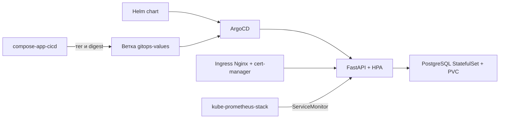

# Kubernetes Ops Lab

[](https://github.com/nikit0id/kubernetes-ops-lab/actions/workflows/ci.yml)

Учебный DevOps-проект: Python HTTP-сервис в локальном двухузловом Kubernetes-кластере на **kind**. Контейнеризация, probes, ресурсы, диагностика `ImagePullBackOff` и откат Deployment.

**Статус:** проект проверен на реальном локальном стенде WSL2: Docker build, два Ready-узла, две реплики, HTTP, DNS/ClusterIP, воспроизведение ImagePullBackOff и rollback. Все 28 тестов прошли на Windows. Текущий результат GitHub Actions — по значку CI выше. Подробности и ссылки на реальные запуски — [docs/verification.md](docs/verification.md). Это учебный стенд, не production-инфраструктура.

## k3s: три узла, ingress-nginx и cert-manager

Стенд из этапа «Кластер» ([issue #3](https://github.com/nikit0id/kubernetes-ops-lab/issues/3)). Тот же HTTP-сервис, но в кластере k3s на локальном Docker: один server с embedded etcd и два agent, встроенный Traefik отключён в пользу ingress-nginx, сертификат выпускает cert-manager.

```bash
python scripts/k3s_lab.py doctor
python scripts/k3s_lab.py up
python scripts/k3s_lab.py verify
```

Стенд изолирован от kind-стенда выше: свой Compose-проект `k3s-lab`, свой kubeconfig `.local/k3s/kubeconfig`, свой контекст `k3s-lab`. Нужны Docker Engine, kubectl, Helm 3 и `openssl` в одной среде. Версия k3s закреплена (`K3S_VERSION`, по умолчанию `v1.34.13-k3s1`); тег `latest` не используется.

`verify` проверяет три Ready-узла, CoreDNS, namespace-ы, условие `Ready` у `Certificate` и реальный HTTPS-ответ через ingress с проверкой цепочки по локальному корневому CA. Подробности, порты, ограничения и удаление — [docs/k3s-cluster.md](docs/k3s-cluster.md).

**Статус этапа:** манифесты, скрипт и проверки покрыты тестами и проходят локально; полный прогон на Docker-хосте с k3s **не выполнялся** в этой среде — Docker здесь недоступен. Фактический результат запуска появится в [docs/verification.md](docs/verification.md) после реального `up`.

## Portfolio API через GitOps

[](https://github.com/nikit0id/kubernetes-ops-lab/actions/workflows/portfolio.yml)

Второй стенд этого репозитория развёртывает общий FastAPI и PostgreSQL. Для него нужен Linux с Docker, kind v0.33, kubectl, Helm 3, Git, jq и OpenSSL. Команды создают отдельный кластер portfolio-gitops и kubeconfig в portfolio/.lab.

```bash
git clone https://github.com/nikit0id/kubernetes-ops-lab.git
cd kubernetes-ops-lab
./scripts/portfolio-up
```



**Что внутри.** По умолчанию стенд собирает закреплённую ревизию portfolio-api и загружает образ в kind. PostgreSQL получает отдельный PVC, пароль генерируется один раз в Kubernetes Secret. HPA использует metrics-server, ServiceMonitor поставляет метрики в Prometheus. Лабораторный Ingress получает локальный сертификат. Для реального домена потребуется доверенный Issuer.

При `PORTFOLIO_IMAGE_MODE=registry ./scripts/portfolio-up` Argo CD читает chart из этого репозитория, а файл образа — из ветки gitops-values репозитория доставки. Там compose-app-cicd публикует тег и digest после успешного тестового деплоя. Если пакет GHCR закрыт, передайте путь к отдельному docker config.json с правом чтения только этого пакета через PORTFOLIO_DOCKER_CONFIG. Для переключения режимов используйте новый одноразовый кластер.

Для просмотра ресурсов: `KUBECONFIG=portfolio/.lab/kubeconfig kubectl -n portfolio get all`. CI проверяет настоящий git push в одноразовое Git-зеркало репозитория и ждёт, пока Argo CD сменит тег, а /health подтвердит доступность базы. Два тестовых тега указывают на одну сборку. В рабочем режиме каждый релиз привязан к digest из GHCR.

### Что я узнал

- TCP liveness проверяет процесс. HTTP readiness проверяет SQL и исключает неготовый Pod из Service.
- StatefulSet связывает имя экземпляра PostgreSQL с PVC. Перезапуск Pod сохраняет его файлы.
- Для подтверждения GitOps нужны SHA синхронизации Argo, фактический образ в Deployment и ответ приложения после rollout.

### Что бы сделал дальше

- Подключить внешний Issuer и внешний тест HTTPS с реальным доменом.
- Проверить время восстановления PVC из S3-бэкапа на новом кластере.

## Что реализовано

- Python-сервис без сторонних runtime-зависимостей: `/`, `/healthz`, `/readyz`.
- Docker-образ с непривилегированным пользователем.
- kind: один control-plane и один worker, версия node image закреплена digest.
- Namespace `ops-lab`, Deployment с двумя репликами, Service типа ClusterIP.
- HTTP readiness/liveness probes, requests/limits CPU и памяти.
- Изолированный kubeconfig, явный контекст `kind-ops-lab` во всех командах скрипта.
- Контролируемая ошибка образа → сбор диагностических данных → `kubectl rollout undo` → повторная HTTP-проверка.
- CI: lint, тесты, проверка схем манифестов, сборка Docker, запуск kind и сценарий восстановления. Успех CI можно утверждать только после реального зелёного запуска.

## Структура

```text
app/server.py             HTTP-сервис
Dockerfile                контейнер без root
kind/cluster.yaml         два узла kind
k8s/                      Namespace, Deployment, Service
k3s/compose/              три узла k3s на Docker Compose
k3s/manifests/            Issuer, Certificate, smoke-workload
k3s/ingress-nginx-values.yaml  настройки контроллера для стенда
scripts/lab.py            команды kind-стенда
scripts/k3s_lab.py        команды k3s-стенда
tests/                    HTTP, манифесты, защитные проверки
.github/workflows/ci.yml   проверки и end-to-end сценарий
docs/                     инцидент, статус проверок, k3s-стенд
```

## 1. Запуск без Docker

Нужен Python 3.13+; команды выполнять из корня репозитория.

**Windows, Git Bash** (не PowerShell и не WSL):

```bash
python -m app.server
```

**Linux / работающий WSL, Bash:**

```bash
python3 -m app.server
```

Сервис слушает `0.0.0.0:8080`, для локальной проверки откройте `http://127.0.0.1:8080/`. Остановка — Ctrl+C. Поле `hostname` позволяет видеть, какой контейнер ответил.

### Тесты на Windows, Git Bash

Если доступен `uv`:

```bash
uv venv .venv
uv pip install --python .venv/Scripts/python.exe -r requirements-dev.txt
./.venv/Scripts/python.exe -m unittest discover -s tests -v
./.venv/Scripts/python.exe -m ruff check .
./.venv/Scripts/python.exe -m ruff format --check .
```

Альтернатива для обычной установки Python с pip:

```bash
python -m venv .venv
./.venv/Scripts/python.exe -m pip install -r requirements-dev.txt
```

### Тесты на Linux, Bash

```bash
python3 -m venv .venv
.venv/bin/python -m pip install -r requirements-dev.txt
.venv/bin/python -m unittest discover -s tests -v
.venv/bin/python -m ruff check .
.venv/bin/python -m ruff format --check .
```

Проверка схем Kubernetes выполняется тестами через `kubernetes-validate`, в строгом режиме для Kubernetes 1.34. Это **не замена** запуску настоящего API-сервера.

## 2. Запуск Kubernetes-стенда

**На текущей машине Docker уже установлен внутри Arch WSL, а не в Windows.** Для повторного запуска готового кластера используйте [инструкцию WSL](docs/wsl-local.md). Команды из Windows Git Bash ниже подходят только если инструменты и Docker доступны непосредственно в Windows.

Нужны работающий Docker Engine в режиме Linux containers, kind **v0.33.0**, kubectl **v1.34.11**, Python 3.13+. Все инструменты должны быть доступны **в одной среде**. Для Windows удобен Docker Desktop с работающим WSL2/гипервизором; здесь его установка не автоматизируется. Не смешивайте Windows kubectl и kubeconfig из другой машины/WSL.

Официальные инструкции: [kind](https://kind.sigs.k8s.io/docs/user/quick-start/), [kubectl](https://kubernetes.io/docs/tasks/tools/), [Docker Desktop для Windows](https://docs.docker.com/desktop/setup/install/windows-install/).

Команды ниже — **Windows Git Bash**. На Linux используйте `python3` вместо `python` либо `.venv/bin/python`.

```bash
python scripts/lab.py doctor
python scripts/lab.py up
```

`up` собирает `ops-lab:1.0.0`, создаёт кластер `ops-lab`, загружает образ в узлы kind, создаёт Namespace, проверяет манифесты через `--dry-run=server` и применяет их. Затем проверяет два Ready-узла, две доступные реплики и три HTTP-endpoint через временный port-forward. Если кластер с таким именем уже существует, `up` откажется менять его.

Kubeconfig записывается только в `.local/kubeconfig` и исключён из Git. Если создание кластера оборвалось, изучите ошибку: повторный `up` может обнаружить частично созданный кластер и намеренно остановиться.

Для просмотра в браузере:

```bash
python scripts/lab.py port-forward
```

Откройте `http://127.0.0.1:8080/`; Ctrl+C завершает port-forward. Если порт занят, освободите его либо используйте `smoke`, который выбирает свободный localhost-порт автоматически:

```bash
python scripts/lab.py smoke
python scripts/lab.py verify
```

**Важно:** `kubectl port-forward service/...` перенаправляет запросы к выбранному Pod. Эта проверка не доказывает балансировку Service и работу полного сетевого пути через ClusterIP. При локальной проверке отдельно выполнен запрос из Pod по DNS-имени Service через ClusterIP — он прошёл; балансировка не проверялась.

## 3. Диагностика и откат

Только на выделенном учебном кластере; команда намеренно меняет образ приложения на несуществующий:

```bash
python scripts/lab.py break-image --confirm-lab-failure
python scripts/lab.py rollback
```

Первый шаг проверяет исправный стенд, задаёт образ `registry.invalid/ops-lab:missing` и ждёт **реальный** `ImagePullBackOff`, после чего выводит Pod describe, events и историю Deployment. Если команда завершилась ошибкой или была прервана после смены образа, выполните `diagnose` и `rollback`.

```bash
python scripts/lab.py diagnose
```

Откат выполняет `kubectl rollout undo`, ждёт восстановления и повторяет HTTP-проверки. Он разрешён только если Deployment использует именно ошибочный образ данного упражнения.

Разбор причины и команды вручную — [docs/incident-runbook.md](docs/incident-runbook.md).

## 4. GitHub Actions

После публикации в GitHub workflow запускается на push и pull request; также доступен ручной запуск. Job `checks` проверяет Python и манифесты. Job `kubernetes` собирает образ, поднимает два узла на временном Ubuntu runner, проверяет приложение, воспроизводит ошибку и выполняет откат. Образы в registry не публикуются, внешние серверы не используются.

Если Actions отключены для аккаунта/репозитория или runner недоступен, end-to-end проверка в GitHub не произойдёт. Успешное локальное развёртывание уже проверено, но утверждать успешно пройденный GitHub Actions можно только после реального зелёного workflow run.

## Ограничения и объяснение решений

- Два узла — не HA: control-plane один. Оба Pod обычно размещаются на единственном worker. Две реплики не означают устойчивость к потере worker.
- Образ загружается через `kind load docker-image`; `IfNotPresent` и явный тег позволяют использовать локальную копию.
- `readinessProbe` влияет на готовность Pod принимать трафик, `livenessProbe` — на перезапуск контейнера. У этого приложения нет БД или внешних зависимостей, поэтому обе проверки простые.
- `maxUnavailable: 0`, `maxSurge: 1`: при ошибочном обновлении старые реплики должны продолжить обслуживать запросы. Это ошибка rollout, не обязательно полный простой сервиса; результат нужно подтвердить на стенде.
- Стандартный `http.server` подходит для этой лабораторной, но не выбран как production application server.
- Python base image закреплён minor-тегом, но не digest: последующие сборки могут получать обновлённые слои. Прямые dev-зависимости закреплены, транзитивные — нет.
- Нет Ingress, TLS, мониторинга и внешней БД: они не нужны для заявленной цели.

## Что уметь объяснить на собеседовании

1. Зачем нужны Deployment и Service, если контейнер уже запускается в Docker?
2. Чем readiness отличается от liveness?
3. Почему локальный Docker-образ нужно загрузить в kind?
4. Где искать причину `ImagePullBackOff` и почему рестарт сам по себе её не устраняет?
5. Что меняет `rollout undo`, и как убедиться, что приложение действительно восстановилось?
